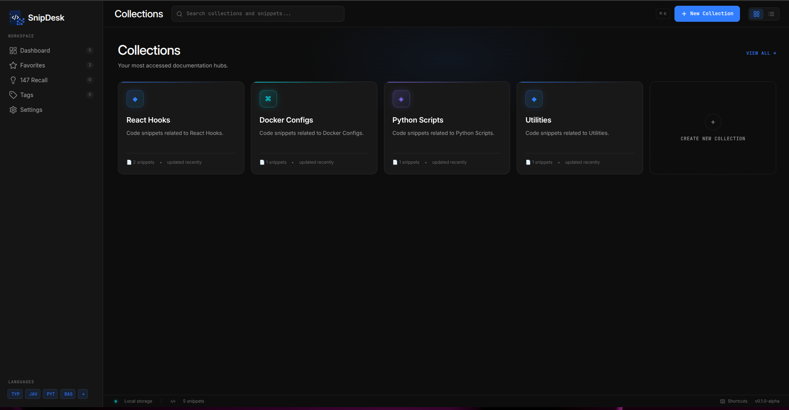
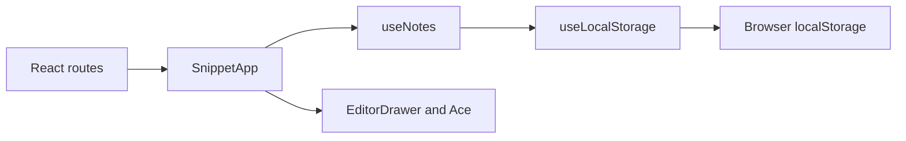

# SnipDesk

A browser-based code notebook for saving snippets with context, organizing collections, and finding useful code again.

SnipDesk treats the code and the reason for keeping it as one note. It combines an Ace-powered editor with collection, tag, and language filters, local persistence, and a scheduled recall workflow.

[Live demo](https://snipdesk.liveon.workers.dev/) · [Issues](https://github.com/sayedrisat/SnipDesk/issues) · [Discussions](https://github.com/sayedrisat/SnipDesk/discussions) · [Contributing](CONTRIBUTING.md)



**Status:** `0.1.0-alpha`, in active development. This is a client-side application; accounts, cloud synchronization, and AI features remain future work.

## What works

- Create, edit, copy, favorite, and delete code notes.
- Save a title, reason, language, tags, and code with each note.
- Search note metadata and code; filter by language and collection.
- Create collections through the current interface; state helpers also support rename/delete, but the current navigation does not expose those controls.
- Persist notes and collections in browser `localStorage`.
- Enable recall for a snippet and advance or reset its scheduled review.
- Edit code in a syntax-aware drawer and browse the workspace in grid or list views.

## Start locally

Use Node.js 22, as specified in [`.node-version`](.node-version), and npm.

```bash
git clone https://github.com/sayedrisat/SnipDesk.git
cd SnipDesk
npm ci
npm run dev
```

Open the URL printed by Vite. `/` is the landing page; `/app` is the notebook workspace.

```bash
npm run build
npm run preview
```

The build produces `dist/`. Development and preview bind to `0.0.0.0`, so they may be reachable from other devices on the local network.

## Architecture



| Area | Implementation |
| --- | --- |
| Routes | [`src/App.jsx`](src/App.jsx) |
| Workspace composition | [`src/pages/SnippetApp.jsx`](src/pages/SnippetApp.jsx) |
| Note, collection, filtering, and recall state | [`src/hooks/useNotes.js`](src/hooks/useNotes.js) |
| JSON persistence | [`src/hooks/useLocalStorage.js`](src/hooks/useLocalStorage.js) |
| Code editing | [`src/components/EditorDrawer.jsx`](src/components/EditorDrawer.jsx), [`CodeField.jsx`](src/components/CodeField.jsx) |

The app uses React, Vite, Tailwind CSS, Ace Editor, Lucide icons, and GSAP. Notes and collections use the `codevault:notes` and `codevault:collections` storage keys. Search runs over the browser's current note state.

## Storage and configuration

The application needs no backend, API key, or environment variables. Notes stay in the current browser profile and origin. Clearing site storage, changing browsers, or opening another origin does not transfer that data. There is no cloud backup or multi-device synchronization.

Keep secrets and production credentials out of snippets. Browser storage is readable by scripts on the same origin, and storage failures are logged rather than providing a durable-write guarantee.

## Usage

1. Open `/app` and choose **New Note**.
2. Enter the code, its language, and a short explanation of why it matters.
3. Organize the note with a collection and tags.
4. Search, copy, favorite, or reopen it in the editor.
5. Enable recall when you want to revisit the snippet later.

## Verification and deployment

`npm run build` verifies production bundling. The repository now has Node-based recall tests and Playwright browser tests. There is no lint script. Browser tests run against a fresh production build and preview server; every test uses an isolated browser context.

```bash
npm run test:unit                       # recall scheduling and due-state boundaries
npx playwright install chromium         # one-time browser installation
npm run test:e2e                        # build + production-preview browser checks
npm test                                # both suites
```

The browser suite covers note creation/edit/deletion across reloads, code/metadata search, language filtering, and collection creation/persistence. It does not yet cover clipboard permissions, favorites, recall advancement through the UI, storage quota failures, or mobile layouts. Collection rename/delete helpers also need direct coverage before their controls are reintroduced.

The CI workflow runs `npm ci`, installs Chromium with its Linux dependencies, and runs both suites on pull requests and pushes to `main`. Include screenshots and the checks actually performed in UI PRs.

The public demo is hosted on Cloudflare. For a static Pages deployment, use `npm run build`, output directory `dist`, and Node 22. Client-side routes such as `/app` need the host's SPA fallback. No deployment credentials belong in the repository.

## Roadmap

Planned areas include JSON import/export, keyboard shortcuts, improved mobile behavior, and richer search. AI explanations, semantic search, external integrations, and cloud synchronization are longer-term ideas. Existing persistence, deletion, and recall should be maintained rather than reintroduced as new features.

## Contributing

Read [CONTRIBUTING.md](CONTRIBUTING.md), check the current issue discussion, and choose a focused change. Run the local UI and production build; attach before/after screenshots for visible changes.

Maintainers: Sayed Risat and Aushah Gowhar.

## License

[MIT](LICENSE).
